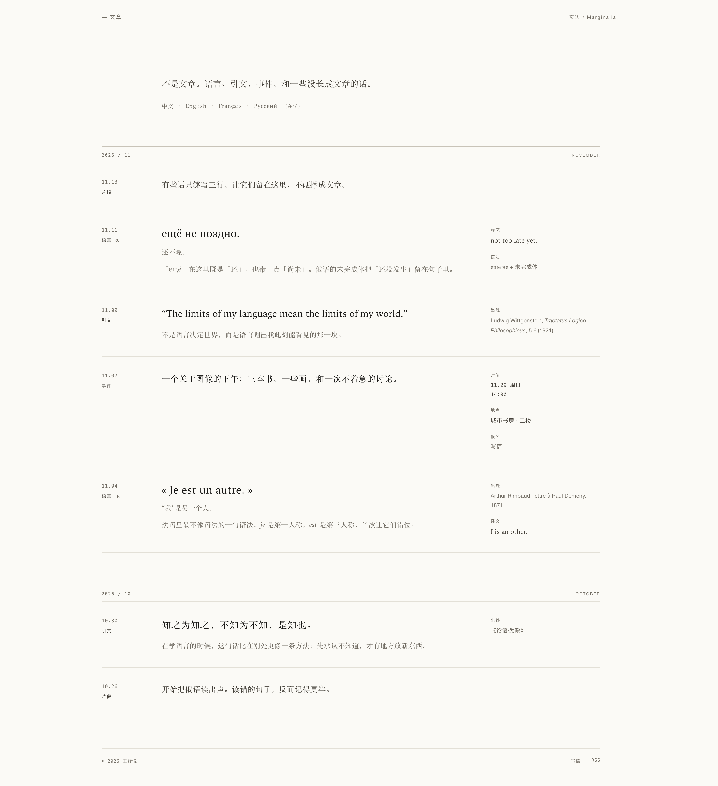

> **旧版 B′ 说明（2026-11 之前）**。当前站点已改为黑底索引 + 独立小说全本 + 技术工作台，见 [README.md](README.md)。旧工作台的页面、截图和 `works.css` 已被替换，下文相关链接可能失效。

# v2 · 已选 B′「工作台」

B′ 定下来了。A′ 保留在 [a-recent/](a-recent/)，只作对照，不再继续。

文章仍然是 5 篇样张：没有总数、没有分类筛选、没有编号、没有归档页。其中一篇是英文，首页直接出现中英文标题。另加一页 [页边](b-desk/notes.html)，放语言、引文、事件和片段；再加一页 [工作台](b-desk/works.html)，放一部小说、一本英文小册和一批论文。姓名从页眉、署名、文章脚注行里拿掉，只在页面末尾的版权行出现一次。

## 姓名

- 首页：左侧只有一句写作范围和联系方式，没有姓名；末尾 `© 2026 王舒悦` 是可见的唯一一次。
- 文章页：顶栏只有“← 文章”和“页边 →”，没有站名；meta 里没有作者；文末版权行一次。
- 页边：顶栏只有“← 文章”，没有姓名；页脚版权一次。输入页 [compose.html](b-desk/compose.html) 不出现姓名。
- 浏览器标题仍保留 `王舒悦`，给标签页和搜索用。

## 多语言排版

不做语言版本，不做 `/en`，不设切换器。一篇文章是什么语言，就按什么语言排；同一套模板容纳所有语言。

- **字体栈**：拉丁字体在前，中文字体在后。英文正文用 Iowan Old Style / Palatino / Georgia，中文落到宋体；英文标题用 Helvetica Neue，中文落到苹方。这样同一段里中英并置时，各自用合适的字形。
- **语言属性驱动排版**：正文、标题、deck 都标 `lang`。中文正文 17px / 1.98，英文正文 18px / 1.70；英文栏宽收窄到 590px，中文保持 660px。英文标题 42px / 1.16，中文标题 40px / 1.42。
- **不自动断词**：英文左对齐，关闭 `hyphens: auto`，避免 `inter-preted`、`atten-tion` 这类断行；只有超长单词才强制断。
- **混排细节**：英文里的中文（如 `工具`）缩到 0.94em 并补字距；中文里的英文书名（如 *The Science of Mind Wandering*）用衬线斜体；标点各按各的语言，不互相改造。
- **界面语言只有一套**：类别、日期、上一篇/下一篇这些微文案仍是中文；内容可以是中文、英文或混排。以后要双语界面，也是同一套界面，不复制页面。

英文样张 [The Quiet Tool](b-desk/quiet-tool.html) 不是《在展厅里走神》的英文版，是另一篇文章；它只是用来验证同一模板下的英文排版。文件名也不带 `-en`。其余中文旧作暂时仍指向同一篇中文样稿，只用于验版式。

页边页再把俄文、法文拉进来：`lang="ru"` / `lang="fr"` 各自拿字体；西里尔字母用 Georgia / Times 兜底，法语的重音和引号直接走拉丁衬线。语言不是单独一栏，而是账本里的几种笔迹。

## 页边



不是另开一个“笔记 / 语录 / 语言 / 活动”栏目，而是把四种东西放进同一条账本：

- **日期在左**：没有标题，日期就是索引；按月份往下接。
- **正文在中**：片段、引文、语言例句、活动邀请都写在这里。
- **出处 / 译文 / 时间地点在右**：像页边注一样退到右侧，不抢正文。
- **类型只改排法**：引文把句子放大、出处退到右栏；语言把原文放大、译文和语法退到右栏；事件把时间、地点、报名放在右栏；片段什么都不加。
- **不做筛选和计数**：七条笔记不假装成一个数据库；月份分隔和日期已经够用。以后多了再加索引，不先做目录。

[页边](b-desk/notes.html) · [样式](b-desk/notes.css) · [参考与取舍](REFERENCES.md)

## 工作台


B+C 混合：B 的抽屉，C 的稿本处理。不是把 vitrine 的文件倒进一张清单，而是给三种材料各自的距离。

- **首页**：五篇文章之后多一个「工作台」区块，三行：`《青年讲师》`、`A Preliminary Mathematical Exegesis of Diffusion Models`、`论文与专利`。没有影像：频道是产品记录，不是写作。
- **小说**：简介、审讯开场节选、七稿的版本墙与版本表、三个旧题、材料构成（只列组和数量）。不公开全稿、原始批注、背景材料和读者姓名；[读者 A–D 的短句只留在调研稿里](../v3/)。
- **小册**：四幅图版整版、序言选段、五章目录。全文尚未上线；现在只放能公开的部分。
- **记录**：30 篇论文两列，8 项专利表。只列题名、刊物、年份和引用数；作者列表和检索说明留在原始清单。论文的 DOI 会指向真名；如果不想让论文和小说笔名绑在一起，先把 DOI 去掉，只留题名和刊物。
- **版式**：抽屉用 B′ 的三栏（资料 / 正文 / 留白）；版本墙和图版用 C 的尺度。纸质、字阶和细线仍然来自 [style.css](b-desk/style.css)。

文件：

- 页面：[b-desk/works.html](b-desk/works.html)
- 样式：[b-desk/works.css](b-desk/works.css)
- 图版：[b-desk/assets/](b-desk/assets/)
- 生成脚本：[b-desk/make_works.py](b-desk/make_works.py)（从 `prototypes/v3/data.json` 读数据；页面本身是静态的）
- 截图：[shots/works-top.png](shots/works-top.png) · [shots/works-home.png](shots/works-home.png) · [shots/works-m.png](shots/works-m.png)

工作台的公开范围是「简介 + 节选 + 版本元数据」；手稿、批注、背景材料和影像暂不进入公开页。

## 手机发布


输入页只有四个键：**记 / 引 / 语 / 事**。没有标题，日期自动；选“引”多一个出处，选“语”多一个语言和译文，选“事”多一个时间、地点和链接。写完按“放上去”。

实际路线建议：

```
手机主屏 / 分享菜单
  → PWA（compose.html 的形态）或 iOS 快捷指令
  → POST /api/note（私密 token）
  → content/notes/2026-11-13.md
  → Vercel / Cloudflare Pages 自动构建
  → 页边
```

- **PWA**：把输入页加到主屏，一点就写；正式上线后隐藏 URL、`noindex`、只接受一个作者 token。
- **iOS 快捷指令**：在 Safari / Kindle / 微信读书里选中一句话，分享到“存进页边”，出处自动带上；这是摘录最快的路径。
- **发布延迟**：静态站重建约 30–60 秒；输入页先回“已收”，不假装已经上线。
- **没有 CMS**：一条 note 就是一个带 frontmatter 的 Markdown 文件，字段是 `type / lang / source / translation / when / place / link`；构建时按月份分组。

输入页是**形态预览**，还没连接发布接口。选定部署和手机之后再接。


## 页面


- 首页：[b-desk/index.html](b-desk/index.html)
- 中文文章：[b-desk/essay.html](b-desk/essay.html)
- 英文文章：[b-desk/quiet-tool.html](b-desk/quiet-tool.html)
- 页边：[b-desk/notes.html](b-desk/notes.html) / [notes.css](b-desk/notes.css)
- 工作台：[b-desk/works.html](b-desk/works.html) / [works.css](b-desk/works.css)
- 手机输入页：[b-desk/compose.html](b-desk/compose.html) / [compose.css](b-desk/compose.css)
- 样式：[b-desk/style.css](b-desk/style.css)
- 截图：[shots/](shots/)

390 / 768 / 1024 / 1440 都检查过，没有横向溢出。公开页面没有脚本；输入页只有切换类型和“已收”状态的一小段脚本。

## 下一步

工作台已经接上第一版：小说、小册、论文与专利。下一步是把五篇文章的占位稿换成真实内容，接页边的发布接口，并决定小册全文和影像是否上线。
