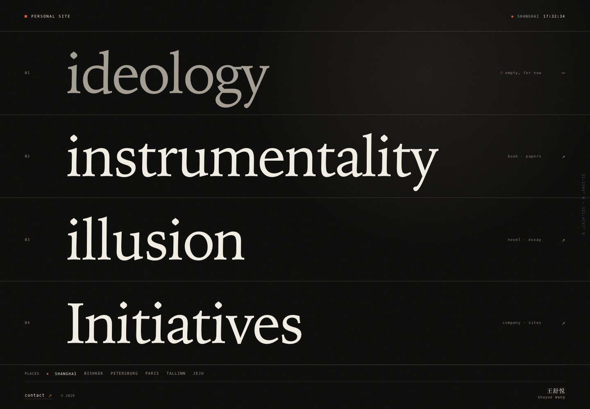

# v2 · 个人网站



首页是近黑封面式索引，姓名缩在右下角；小说、论文、技术、文章、页边各自一页；全站去掉页首概述，取消年表；政论先空着。

## 页面

| 页面 | 文件 |
|---|---|
| 首页 | [b-desk/index.html](b-desk/index.html) |
| 联系 | [b-desk/contact.html](b-desk/contact.html) |
| 小说《青年讲师》 | [b-desk/novel.html](b-desk/novel.html) |
| 论文与专利 | [b-desk/papers.html](b-desk/papers.html) |
| instrumentality | [b-desk/instrumentality.html](b-desk/instrumentality.html) |
| book | [b-desk/exegesis.html](b-desk/exegesis.html) |
| Initiatives | [b-desk/initiatives.html](b-desk/initiatives.html) |
| 中文文章 | [b-desk/essay.html](b-desk/essay.html) |
| 英文文章 | [b-desk/quiet-tool.html](b-desk/quiet-tool.html) |
| 页边 | [b-desk/notes.html](b-desk/notes.html) |

## 各页

- **首页**：近黑书封；四类索引占满一屏，悬停整行反白；`ideology` 暂时空着。姓名缩到右下角，没有自我介绍、日期、年表。
- **联系**：两个邮箱、LinkedIn 与 GitHub；邮箱可一键复制。
- **小说**：第七稿全文（331 个正文段落、5 个部分、15 个小节）；纸面标题页 + 正文 + `M·贺六浑 · 未刊稿` 固定水印 + 红色「未刊稿 / 请勿转载」小章。没有简介、版本表、读者批注。
- **论文**：英文书目，按发表年份倒序；每条保留类型（journal / conference / preprint）、DOI、被引与 Google Scholar 检索链接。论文 30 篇、专利 8 项，专利含公开号、发明人、申请/公开日与 Google Patents 链接；源表见 `vitrine/wang-shuyue-fudan-patents.md`。
- **instrumentality**：两个条目——书与论文；书的 URL 是 `exegesis.html`，不再使用 booklet。
- **book**：`A Preliminary Mathematical Exegesis of Diffusion Models`；四幅图版、序言、五章目录，正文只保留英文。
- **Initiatives**：三张卡片（videomp3word.com / autoslide.cc / rurussian.com），每张带类型、简介和状态。
- **文章**：保留四篇样张，去掉 deck；政论先空着。
- **页边**：去掉页首说明，直接进账本。

## 设计

- 封面：`#0b0b0a` 近黑、象牙白衬线大字、朱红记号；首页与联系页共用 `cover.css` / `cover.js`。
- 内页：纸底 `#f7f7f5`；正文用宋体，元数据用等宽。
- 小说单独做成一本书的样子：标题页、页码栏、正文、水印；不是首页的主角。
- 论文页用英文书目排版：作者行、题名、斜体刊名、卷期页码、DOI、被引与 Scholar 链接；专利单独列在页尾。
- instrumentality 只保留两个入口；Initiatives 用纸底卡片网格。
- 没有页面概述：文章页没有 deck，页边没有引子，instrumentality 没有导语，小说没有内容简介。

## 文件与重建

```
prototypes/v2/b-desk/
├── index.html / index.css       封面首页（四类索引）
├── contact.html / contact.css   联系页（邮箱 / LinkedIn / GitHub）
├── cover.css / cover.js         封面共用样式与交互
├── favicon.svg                  站点图标
├── personal.css                 纸底共用样式
├── novel.html / novel.css       第七稿全文 + 水印
├── make_novel.py                从 docx 生成小说页
├── instrumentality.html / section.css  书籍与论文入口
├── exegesis.html / exegesis.css       技术书籍（英文）
├── papers.html / papers.css            学术论文页（英文）
├── initiatives.html / initiatives.css   三张项目卡片
├── essay.html / quiet-tool.html        四篇样张，已去掉 deck
├── notes.html / notes.css       页边，已去掉引子
├── style.css                    文章 / 页边用的纸底样式
└── assets/                      四幅图版
```

当前页面直接在 `b-desk/` 里维护，用 `build.py` 装配。`make_*.py` 是早期生成记录（小说 / 论文 / 工作台），运行会覆盖现有页面，不作为当前发布流程。

原始材料不动。小说读取 `vitrine/novel贺六浑青年讲师202112/第七稿【为了通过审查】.docx`；论文读取 `vitrine/wang-shuyue-fudan-publications.md`；技术书籍读取 `prototypes/v3/data.json`。

## 截图

- [封面首页](b-desk/shots/cover-1440.jpg) · [联系](b-desk/shots/contact-1440.jpg)
- [小说](b-desk/shots/novel-1440-top.png)
- 手机：[封面首页](b-desk/shots/cover-390.jpg) · [联系](b-desk/shots/contact-390.jpg)

## 说明

- 首页的文章仍是四篇样张；政论空着；以后把真实文章放进来即可。
- 论文页会显示作者名单和 DOI；如果不想让论文和小说笔名绑在一起，把 DOI 去掉或把论文页放私密。
- 旧的 B′ 说明在 [README-b-prime.md](README-b-prime.md)。A 年表、深色小说海报、工作台论文列表都已取消。
