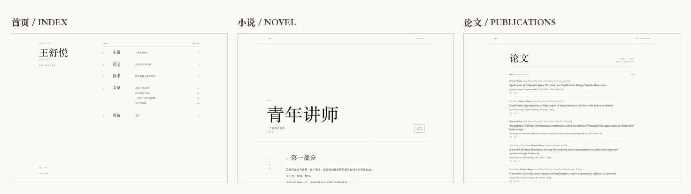

# v2 · 个人网站



首页是姓名 + 索引，不是作品海报。小说、论文、技术、文章、页边各自一页；全站去掉页首概述，取消年表；政论先空着。

## 页面

| 页面 | 文件 |
|---|---|
| 首页 | [b-desk/index.html](b-desk/index.html) |
| 小说《青年讲师》 | [b-desk/novel.html](b-desk/novel.html) |
| 论文与专利 | [b-desk/papers.html](b-desk/papers.html) |
| 技术 / 工作台 | [b-desk/works.html](b-desk/works.html) |
| 技术书籍 | [b-desk/booklet.html](b-desk/booklet.html) |
| 中文文章 | [b-desk/essay.html](b-desk/essay.html) |
| 英文文章 | [b-desk/quiet-tool.html](b-desk/quiet-tool.html) |
| 页边 | [b-desk/notes.html](b-desk/notes.html) |

## 各页

- **首页**：纸底；左边 `王舒悦 / Shuyue Wang / 小说 · 研究 · 技术`，右边 01–05 索引：小说、论文、技术、文章、页边。没有自我介绍、日期、年表。政论不出现。
- **小说**：第七稿全文（331 个正文段落、5 个部分、15 个小节）；纸面标题页 + 正文 + `M·贺六浑 · 未刊稿` 固定水印 + 红色「未刊稿 / 请勿转载」小章。没有简介、版本表、读者批注。
- **论文**：学术条目。作者、题名、刊名、卷期、年份、DOI、被引；分「期刊论文 / 会议与章节 / 预印本 / 专利」。期刊 24、会议 3、预印本 3、专利 8。
- **技术**：工作台只有条目，没有小节和概述。现在一条 `BOOK`，指向技术书籍；以后技术博客直接加 `POST` 行。条目下面放四幅图版预览，不另加标题。
- **技术书籍**：`A Preliminary Mathematical Exegesis of Diffusion Models`，四幅图版、序言、五章目录。
- **文章**：保留四篇样张，去掉 deck；政论先空着。
- **页边**：去掉页首说明，直接进账本。

## 设计

- 纸底：`#fbfaf6`；姓名和正文用宋体，元数据用等宽。
- 首页两栏：300px 姓名栏 + 索引；没有大图和黑色封面。
- 小说单独做成一本书的样子：标题页、页码栏、正文、水印；不是首页的主角。
- 论文页用学术排版：作者行、题名、斜体刊名、卷期页码、DOI、被引。
- 技术页极简：一行类型、一行题名；四幅图版做无标题预览。
- 没有页面概述：文章页没有 deck，页边没有引子，工作台没有导语，小说没有内容简介。

## 文件与重建

```
prototypes/v2/b-desk/
├── index.html / index.css       首页（姓名 + 索引）
├── personal.css                 纸底共用样式
├── novel.html / novel.css       第七稿全文 + 水印
├── make_novel.py                从 docx 生成小说页
├── papers.html / papers.css     学术论文页
├── make_papers.py               从 publications.md 解析作者/刊名/DOI
├── works.html / workbench.css   技术条目
├── booklet.html / booklet.css   技术书籍
├── make_workbench.py            生成 works + booklet
├── essay.html / quiet-tool.html 四篇样张，已去掉 deck
├── notes.html / notes.css       页边，已去掉引子
├── style.css                    文章 / 页边用的纸底样式
└── assets/                      四幅图版
```

生成：

```bash
cd prototypes/v2/b-desk
python3 make_novel.py
python3 make_papers.py
python3 make_workbench.py
```

原始材料不动。小说读取 `vitrine/novel贺六浑青年讲师202112/第七稿【为了通过审查】.docx`；论文读取 `vitrine/wang-shuyue-fudan-publications.md`；技术书籍读取 `prototypes/v3/data.json`。

## 截图

- [首页](b-desk/shots/index-1440.png)
- [小说](b-desk/shots/novel-1440-top.png)
- [论文](b-desk/shots/papers-1440-top.png)
- [技术](b-desk/shots/works-1440.png)
- [技术书籍](b-desk/shots/booklet-1440.png)
- 手机：[首页](b-desk/shots/index-390.png) · [论文](b-desk/shots/papers-390.png) · [技术](b-desk/shots/works-390.png) · [技术书籍](b-desk/shots/booklet-390.png)

## 说明

- 首页的文章仍是四篇样张；政论空着；以后把真实文章放进来即可。
- 论文页会显示作者名单和 DOI；如果不想让论文和小说笔名绑在一起，把 DOI 去掉或把论文页放私密。
- 旧的 B′ 说明在 [README-b-prime.md](README-b-prime.md)。A 年表、深色小说海报、工作台论文列表都已取消。
