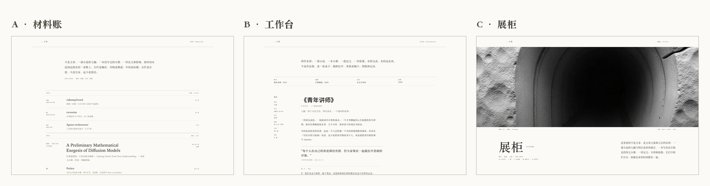

# vitrine · 三种放法

把 `vitrine/` 底下的材料放进 B′「工作台」，试了三种内容与形式。三套都能点开，首页和材料页都有；区别只在材料被放在哪里、以什么形式出现。

**先从 [index.html](index.html) 看起**：一页对照，三套的首页与材料页截图、横向比较、推荐和需要先定的三件事。



> **2026-11 重构**：这一版已经不是 B + C 工作台。当前站点是纸底个人站：首页姓名 + 索引；小说单独成页（第七稿全文 + 水印）；论文独立成学术页；工作台只放技术条目；A 的年表取消。当前站点见 [v2/b-desk/index.html](../v2/b-desk/index.html)。以下三套样张只作历史记录。

---

## 这一轮做了什么

- 盘点了 `vitrine/` 的 60 个文件，分成四组：**稿本**（小说）、**图版**（英文小册）、**记录**（论文与专利）、**影像**（YouTube 产品录屏）。
- 用真实的标题、日期、字数、页数、批注数和图版，做了三套静态样张；没有改 `vitrine/` 里的任何原始文件。
- 三套共用 B′ 的纸色、字阶、细线和侧栏语法；差异只在材料的组织方式。
- 读者姓名在样张里匿名成「读者 A–D」，文件名也做了同样的处理；原始文件不动。
- 桌面 1440 和手机 390 都检查过，没有横向溢出。

## 材料盘点

| 组 | 文件 | 时间 | 体量 | 形态 | 公开建议 |
|---|---:|---|---|---|---|
| 稿本《青年讲师》 | 45 | 2021.11–12 | 七稿；末稿约 3.4 万字；4 位读者、302 处批注/修订 | docx / pdf / xlsx | 简介、节选、版本元数据可公开；全稿、原始批注、背景材料暂不公开 |
| 图版《扩散模型阐释》 | 12 | 2025.06 | 序 + 四章，约 20,251 词；4 幅图版 | Markdown / PNG | 可公开；英文技术文本，建议目录 + 图版 + 选段 |
| 论文与专利 | 30 + 8 | 2014–2025 | 662 次引用（OpenAlex，2026-11-14） | Markdown 清单 | 可公开；DOI 会指向真名 |
| 影像 | 35 | 2026.01–08 | 约 5 小时；3 个系列 | YouTube | 产品记录，不是作品；建议不进首页，或只放页脚 |

### 稿本的七稿

| 稿 | 日期 | 字数 | 相对上一稿 |
|---|---|---:|---:|
| 一稿（分日手稿） | 11.19–11.28 | 约 2.2–2.6 万 | — |
| 二稿 | 11 月末 | 30,867 | — |
| 三稿 | 12.02 | 33,730 | 11% |
| 四稿 | 12.03 | 34,060 | 5% |
| 五稿 | 12.06 | 35,052 | 2% |
| 六稿 | 12.11 | 34,704 | 4% |
| 七稿（审查版） | 12.11 后 | 34,484 | 1% |

标题变化：《课题组谋杀嫌疑犯》→《讲师陶吕之死》→《课题组之死》→《青年讲师》。六稿起署名 M·贺六浑。

读者批注：PDF 批注 15 / 60 / 55 处，Word 修订 172 处。样张只引用短句，姓名匿名。

## 三种放法

### A · 材料账 —— [首页](a/home.html) / [材料页](a/index.html)

一条按年份从近到远的账。左栏是稿次、刊物或频道；中间是标题；右栏是字数、页数、条数。没有图，只有一条条线。

- 首页只多一行「材料账」链接，和侧栏一个「材料」。
- 2026 影像 → 2025 图版与论文 → 2024–2015 论文 → 2021 稿本与论文 → 专利附录。
- 小说的七稿和四位读者都在 2021 年里，和五篇论文排在一起；材料清单折叠在账本里，展开是 45 个文件名。
- 优点：最省，最像原来的站；维护只要加行。
- 代价：小说被埋在 2021 年；论文和影像比稿本更抢行；整体像简历。

### B · 工作台 —— [首页](b/home.html) / [工作台](b/index.html)

四只抽屉：稿本、图版、记录、影像。每只抽屉有自己的左栏资料、正文和材料目录。

- 首页在五篇文章后多一个「工作台」区块，四条：小说、小册、论文与专利、影像。
- 稿本抽屉：简介、写作目的引文、审讯开场节选、七稿表、四位读者、45 份材料目录。
- 图版抽屉：英文小册、图版 I、序言选段、五章目录、一条前向过程公式。
- 记录抽屉：30 篇论文两列、8 项专利表。
- 稿本的材料目录在样张里默认展开；正式版可以默认收起。
- 影像抽屉：3 个系列、样本条目；页面里直接写了「可以整段撤掉」。
- 优点：材料各得其所；小说有足够的篇幅；以后加作品不用改结构。
- 代价：多四页；容易像作品集；小说和论文用同一种抽屉，语气会打架。

### C · 展柜 —— [首页](c/home.html) / [展柜](c/index.html)

一页展览。手稿影印、版本墙、四幅图版在前；论文退成一面题名墙，影像退成一条刻度。

- 首页在五篇文章后多一张图版和「展柜」入口；侧栏上方多一个「展柜 →」。
- 稿本：手稿影印（第四稿页 3）、红色页边批注放大、四段引文、六根版本条、三个旧题。
- 图版：四幅整版图版、小册标题、序言引文、五章目录、一条公式。
- 记录：30 条论文题名墙；影像是一条 35 个刻度的长条，标注可撤。
- 优点：材料本身成为作品；小说和四幅图版都得到了最好的观看距离；一页就够。
- 代价：论文和影像不太适合展览；手稿与批注的公开风险最高；图像权重大，和原来的站距离最远。

## 推荐

**B 的骨架 + C 的稿本处理，论文和影像压成记录。**

小说值得 C 的版本墙和影印页；但不该把整站变成展柜。小册可以用 B 的一章一条 + 四幅图版；论文和专利回到 A 的账；影像整段撤掉，或只留页脚链接。

- 保留：简介、节选、版本表、匿名批注、四幅图版、论文目录。
- 不公开：全稿、原始批注、真实事件材料、读者姓名。
- 可选：影像、专利表、小册全文连载。

如果只想最小改动，选 A；如果想让材料本身成为作品，选 C；如果想让站从「文章」长成「作品站」，选 B。

## 需要先定的三件事

1. **小说公开到哪一层？** 简介 + 节选 / 全文 / 只列目录 / 密码保护的私密档案。
2. **用不用真名？** 小说署 M·贺六浑；论文 DOI 指向真名；影像频道是第三个名字「Henri Wang」。绑不绑在一起是内容决定，不是排版决定。
3. **小册怎么发？** 四章连载 / 只放目录 + 图版 / 只给 PDF。

## 注意：隐私与名誉

《青年讲师》以 2021 年复旦青年教师事件为底，是 roman à clef；材料里还有真实事件剪报、外界评论，以及四位读者的批注。公开全稿、原始批注或读者姓名，可能涉及隐私与名誉风险。

样张因此做了三件事：读者匿名；文件名匿名；背景材料只列目录、不链原文。正式上线前建议：

- 公开简介、节选、版本元数据和匿名批注；
- 全稿与背景材料放在密码保护的私密档案里（`noindex`），或等小说正式出版后再放；
- 公开页加一句「本书为虚构作品」；
- 读者引文先取得同意，或只保留改写到不可辨认的短句。

影像频道是产品记录，不是写作；它会把「Henri Wang」这个身份和站绑在一起。论文的 DOI 也会把真名和文学笔名绑在一起。这两件事需要先决定，再决定排版。

## 文件

```
prototypes/v3/
├── index.html            三种放法对照页（建议先看）
├── a/                    方案 A：首页 + 材料账
├── b/                    方案 B：首页 + 工作台
├── c/                    方案 C：首页 + 展柜
├── assets/               共用样式、图版、手稿影印
├── shots/                桌面与手机截图
├── data.json             由 prepare_data.py 生成的整理数据
├── prepare_data.py       从 vitrine/ 读取论文、影像、稿本数据
├── build.py              A 页面
├── build_b.py            B 页面
├── build_c.py            C 页面
├── build_home.py         三个首页
├── choose.css            对照页样式
└── a/a.css, b/b.css, c/c.css
```

原始材料仍在 `vitrine/`，没有移动、改名或删除。

### 重建

```bash
cd prototypes/v3
python3 prepare_data.py
python3 build.py
python3 build_b.py
python3 build_c.py
python3 build_home.py
```

截图用本机 Chrome + Playwright（`channel="chrome"`）。三个材料页和三个首页的桌面 / 手机截图都在 `shots/`。

## 说明

- 论文题名、刊物、年份、DOI、引用数来自 `vitrine/wang-shuyue-fudan-publications.md`；引用数是 OpenAlex 2026-11-14 的值。
- 影像的条数、系列、时长来自 `vitrine/youtube-henriwang8603-作品清单.md`；样张不显示播放量。
- 小说字数是对 docx 正文去空白后的字符数；「相对上一稿」是 `difflib` 的相似度换算，只用来表示改动幅度。
- 四幅图版来自小册的 `fig_ch01–04.png`；手稿影印来自 `青年教师(1)jie的改动.pdf` 的第 3 页。样张里没有放全稿正文。
- 这是样张，不是最终内容。等选定方案和公开范围后，再把真实内容接进去。
