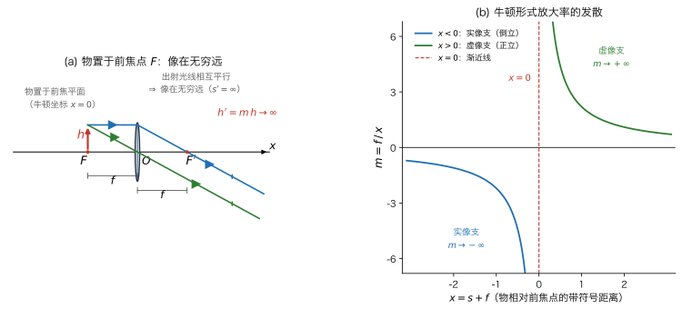

# 前焦点处的横向放大率：为什么 $m=h'/h$ 发散为正无穷大

> 问题：对于横向放大率 $m=h'/h$，当物置于前焦点 $F$（物方焦点）时，为什么 $m$ 趋于无穷大？此时 $h'$ 与 $h$ 分别是什么？

## 0. 结论

物恰好置于前焦点 $F$（即物面与前焦平面重合）时：

- 出射光为平行光，像位于无穷远，即像距 $s'\to\infty$；
- 横向放大率发散，$m=h'/h\to\infty$（更准确地说是 $|m|\to\infty$，符号取决于趋近方向）；
- $h$ 保持有限且非零，$h'=m\,h$ 因而发散——**不存在有限位置、有限大小的实像**。

这一"无穷大"具有极限意义：它是物距趋于焦距时的理想化极限，而非可实际观测的物像关系。

## 1. 符号约定

采用带正负号的笛卡尔坐标符号系统，主光轴右向为正：

| 符号 | 意义 |
|---|---|
| $O$ | 薄透镜光心，取为坐标原点 $x=0$ |
| $s$ | 物距（带符号）：实物 $s<0$，虚物 $s>0$ |
| $s'$ | 像距（带符号）：实像 $s'>0$，虚像 $s'<0$ |
| $f$ | 焦距（带符号）：凸透镜 $f>0$，两侧同为空气时 $f'=f$ |
| $F$ | 前焦点（物方焦点），坐标 $x_F=-f$ |
| $F'$ | 后焦点（像方焦点），坐标 $x_{F'}=f$ |
| $h$ | 物高（带符号），$h'>0$ 表示正立 |
| $m=h'/h$ | 横向放大率 |

高斯公式取
$$
\frac{1}{s'}-\frac{1}{s}=\frac{1}{f}. \tag{1}
$$

## 2. 横向放大率的两种形式

### 2.1 高斯形式

利用过光心 $O$ 的射线（不偏折），由相似三角形可得
$$
m=\frac{h'}{h}=\frac{s'}{s}. \tag{2}
$$

例如物在二倍焦距处 $s=-2f$，则 $s'=2f$，$m=-1$，即倒立等大实像，符号负号表示倒立。

### 2.2 牛顿形式

从焦点 $F$、$F'$ 起算带符号距离 $x,\,x'$：
$$
x=s-x_F=s+f,\qquad x'=s'-x_{F'}=s'-f.
$$
代入式 (1)，整理得牛顿物像关系
$$
x\,x'=-f^{\,2}. \tag{3}
$$
将 $x'=-f^2/x$ 代入 $m=s'/s=(x'+f)/(x-f)$，化简得牛顿形式的横向放大率
$$
m=\frac{h'}{h}=\frac{f}{x}=-\frac{x'}{f}. \tag{4}
$$

> 注：部分教材把 $x$ 定义为自 $F$ 向左（逆光传播方向）取正的距离，此时式 (4) 写作 $m=-f/x$。符号差异源于 $x$ 的正向约定，发散结论不受影响，见第 3 节。

## 3. 物恰在前焦点：为什么 $m\to\infty$

### 3.1 代数推导

物置于前焦点 $F$，即 $s=x_F=-f$。由牛顿变量
$$
x=s+f=0.
$$
代入式 (4)：
$$
m=\frac{f}{x}=\frac{f}{0}\to\infty. \tag{5}
$$

用高斯形式同样可得：式 (1) 令 $s=-f$，有
$$
\frac{1}{s'}=\frac{1}{f}-\frac{1}{f}=0\qquad\Longrightarrow\qquad s'=\infty. \tag{6}
$$
即像距发散。再由式 (2)，$s'=\infty$、$s=-f$ 有限，故 $|m|=|s'/s|\to\infty$。

### 3.2 物理解释

从位于 $F$ 的物点发出的光，经透镜后平行于主光轴出射；从位于前焦平面内任意一点的物点发出的光，经透镜后成为一族平行光线（平行于从该点到光心连线所对应的倾角）。平行光线只在无限远处"相交"，对应：
- 像距 $s'=\infty$；
- 不存在有限距离上的实像。

把物体视为有限高度 $h\neq0$ 的线段置于前焦平面时，每一物点族出射光保持平行且彼此之间的几何关系不变——像在无穷远"展开"，形式化地表现为 $h'\to\infty$。

## 4. 此时 $h'$ 与 $h$ 分别是什么

| 量 | 取值 | 说明 |
|---|---|---|
| $h$ | 有限、非零 | 物体的实际高度，是可直接测量的几何量 |
| $h'$ | $\infty$（极限意义） | $h'=m\,h$，因 $m\to\infty$ 而发散 |

**精确表述**：$h'\to\infty$ 并非存在一个位于有限处的"巨大的像"，而是指下述极限过程——当物距 $s$ 从两侧趋于 $-f$（即物面趋向前焦平面）时，像距与像高同时发散，且发散速率满足 $m=h'/h\sim f/x$。物距恰好等于焦距这一孤立点上，光学系统根本不给出有限实像，故 $h'$ 在该点不取有限值。

若物体完全退化为轴上的一个点（$h=0$），则其像也退化为一条沿轴的平行光线，$m$ 的上述比率出现 $0/0$ 型不定式；此时宜改用角放大率（出射角/入射角）来描述，不再讨论横向放大率。

## 5. 示意图

分图 (a) 为光路图：物置于前焦平面（牛顿坐标 $x=0$），过光心 $O$ 与平行于主光轴的**两条特征光线在像方相互平行**，二者永不相交，对应"像在无穷远"；物高 $h$ 有限，而 $h'=m\,h\to\infty$。

分图 (b) 为牛顿形式放大率 $m=f/x$ 随 $x$ 的变化：$x=0$（物在前焦点）处为垂直渐近线，从实像支（$x<0$，倒立）与虚像支（$x>0$，正立）两侧 $|m|$ 均发散；与图 (a) 的物理解释互为印证。

图中符号与正文一致：$O$ 为光心，$F,\,F'$ 为前、后焦点，$f$ 为焦距，$h$ 为物高；光线自左向右传播，主光轴右向为正。

## 6. 易混淆点

1. **"放大率为无穷大"≠"出现无限大的实像"**。它刻画的是像距发散：像退到无穷远，且随物面趋向前焦平面而无限放大。
2. **前焦点处不成有限实像**。物在焦点上，像距 $\to\infty$，对应物像位置关系曲线中的垂直渐近线 $l=-f$。
3. **符号约定无关紧要**。无论采用 $m=-f/x$ 还是 $m=f/x$，$x\to0$ 时 $|m|\to\infty$ 的结论一致。