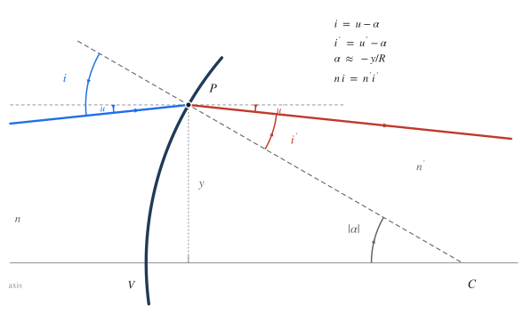
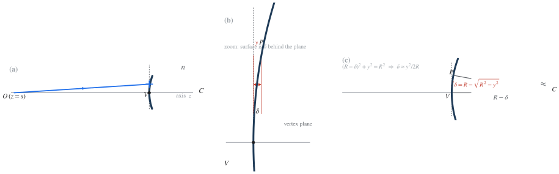
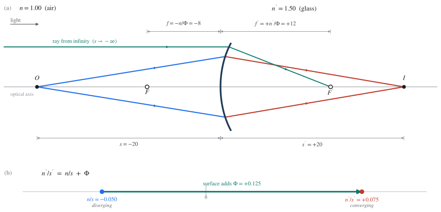

# Optical Power and Focal Length: A Paraxial Bridge Between Geometry and Optics

This is a supplement to page 7 'Refractive and Reflective Surfaces' in the book 'Field Guide to Geometrical Optics'.

## Introduction

In optics, a curved refracting surface is described by two closely related quantities. The first is its power—how strongly the surface bends light. This is a property fixed by the geometry of the surface (its curvature) and by the materials on either side (their refractive indices). The second is its focal length—an optical distance: the distance from the surface to the point where a beam that arrives parallel to the axis comes to a focus (or from which it appears to diverge). Power is a property of the surface itself; focal length is a distance that follows from it. The two are linked through a first-order relation that reduces the behavior of a spherical surface to simple algebra, and that relation is exact only in the small-angle (paraxial) approximation.

This essay proceeds in order, defining every quantity where it first becomes necessary. It begins with the power of a single spherical refracting surface, expressed in terms of curvature and refractive indices. It then fixes the sign conventions for the axial distances, and derives the relation between object distance and image distance for such a surface from the basic law of refraction together with the geometry of the sphere. Reading that relation with the object at infinity defines the focal lengths. A final section returns to the approximations on which the whole derivation rests.

## Power as a Geometric Quantity

Consider a spherical refracting surface of radius of curvature $R$ separating two media with refractive indices $n$ (before the surface) and $n'$ (after the surface). In the paraxial regime—small angles with the optical axis—the surface power is defined as

$$
\Phi = \frac{n' - n}{R}.
$$

This expression shows that power depends on two things: the index contrast $n' - n$ and the curvature $1/R$. A steeper surface (smaller $|R|$) or a larger jump in refractive index produces a stronger bending effect. Once the sign of $R$ is fixed (positive when the center of curvature lies to the right of the vertex), the sign of $\Phi$ indicates whether the surface adds convergence (positive power) or divergence (negative power) to a passing bundle.

Power is therefore an intrinsic property of the surface, given the two media: it sets a characteristic length scale, $1/\Phi$, but not a location. Where a given beam actually comes to a focus depends on the refractive index of the image space and, for a finite object, on the object position. That location is determined in the sections that follow.

## Axial Distances and Their Signs

All axial distances are measured from the surface vertex along the axis. Under the common Cartesian sign convention:

- Light travels from left to right.
- The surface vertex is at $z = 0$.
- $s$ is negative for a real object to the left of the surface.
- $s'$ is positive for a real image to the right of the surface.
- $R$ is positive if the center of curvature lies to the right of the vertex.

The signed object distance $s$ is the $z$-coordinate of the object point, and the signed image distance $s'$ that of the image point, both measured from the vertex. A real object at infinity is represented by $s \to -\infty$. Some textbooks use a positive object-distance convention and write the working equation with different signs; the physics is unchanged, but the signs must be applied consistently throughout.

## Derivation from Snell’s Law and Surface Geometry

The relation between object and image distances is not an independent postulate. It follows from Snell’s law,

$$
n \sin i = n' \sin i',
$$

together with the geometry of a spherical surface, in the limit of small angles. Consider a paraxial ray that strikes the surface at height $y$ above the axis. Let

- $u$ be the angle of the incident ray with the optical axis,
- $u'$ be the angle of the refracted ray with the axis,
- $\alpha$ be the angle of the surface normal with the axis.

All three are signed angles measured from the $+z$ axis (the optical axis, with light traveling left to right); positive means the direction is rotated toward $+y$. The normal is taken in the direction that points into the second medium: for a surface with $R>0$, that is the direction from the hit point toward the center of curvature $C$ (for $R<0$ it points away from $C$).

For a spherical surface near the vertex, the normal angle is approximately

$$
\alpha \approx -\frac{y}{R}.
$$

For the sphere the exact relation is $\sin\alpha = -y/R$; the paraxial approximation replaces the sine by its argument. The minus sign says that, for $R>0$, the normal at a point above the axis tilts downward toward the axis (and upward for a point below it).

The angles of incidence and refraction relative to the normal are then

$$
i = u - \alpha, \qquad i' = u' - \alpha.
$$

These are ordinary angle bookkeeping: the angle a ray makes with the normal is its inclination to the axis minus the normal’s inclination to the axis. They hold for angles of any size; the paraxial step is only the replacement of $\sin\theta$ by $\theta$ in Snell’s law, which comes next. Figure 2 shows this bookkeeping at the hit point.

**Figure 2.** Local geometry at the point $P$ where the ray meets the surface (angles exaggerated for legibility; not to scale). The dashed line through $P$ and the center of curvature $C$ is the surface normal—and also a radius, so $PC=R$. Its tilt from the axis has magnitude $|\alpha|$, with $\sin|\alpha|=y/R$ exactly and $|\alpha|\approx y/R$ paraxially; for $R>0$ the signed angle is $\alpha=-y/R$. All angles are measured from the axis, so the angles of incidence and refraction are $i=u-\alpha$ and $i'=u'-\alpha$. In the small-angle limit Snell’s law $n\sin i=n'\sin i'$ becomes $n i=n'i'$; substituting the angle relations then yields the ray equation $n'u'=nu-\Phi y$, whose term $-\Phi y$ is the surface’s kick.

In the paraxial approximation, $\sin \theta \approx \theta$, so Snell’s law becomes

$$
n i = n' i'.
$$

Substituting the angle relations gives

$$
n(u - \alpha) = n'(u' - \alpha).
$$

Rearranging,

$$
n' u' = n u + (n' - n)\alpha.
$$

Now insert $\alpha \approx -y/R$:

$$
n' u' = n u - \frac{n' - n}{R} y.
$$

Defining the surface power $\Phi = (n' - n)/R$, we obtain the paraxial refraction law in ray form:

$$
n' u' = n u - \Phi y.
$$

This equation has a clear physical meaning: the term $-\Phi y$ is the “kick” that the curved surface imparts to the ray. The ray’s reduced slope $n u$ changes by an amount proportional to the surface power and the ray height. This is also where the combination $(n'-n)/R$ earns the name power: it is precisely the coefficient that converts ray height into a change of reduced slope.

To connect this ray picture to object and image distances, consider a ray leaving an axial object at position $s$ and arriving at the surface at height $y$. To first order the hit point may be taken in the vertex plane, since the sagitta of the sphere is $O(y^2/R)$. The sagitta is the axial offset between the vertex plane and the curved surface at height $y$; the curved surface is reached only after the ray has travelled an extra distance $\delta = y^2/(2R) + O(y^4/R^3)$ beyond the vertex plane (Figure 3). Its slope is

**Figure 3.** The sagitta of the spherical surface. **(a)** A paraxial ray from the axial object at $z=s$: the straight ray crosses the vertex plane ($z=0$, dashed) at exactly height $y$, while the true curved surface is met a distance $\delta$ to the right. **(b)** Magnified vertex region: surface and vertex plane differ by the sagitta $\delta \ll y$. **(c)** Exact circle geometry: in the right triangle $(R-\delta)^2 + y^2 = R^2$, expanding gives $\delta = R-\sqrt{R^2-y^2} \approx \tfrac{1}{2} y^2/R$, so the departure is $O(y^2/R)$. (Angles, heights, and $\delta$ are exaggerated; not to scale.)

$$
u = \frac{y}{0 - s} = -\frac{y}{s}.
$$

After refraction, the ray travels to the axial image at $s'$, so its slope is

$$
u' = \frac{0 - y}{s' - 0} = -\frac{y}{s'}.
$$

Substituting these into $n' u' = n u - \Phi y$ yields

$$
n'\left(-\frac{y}{s'}\right) = n\left(-\frac{y}{s}\right) - \Phi y.
$$

Dividing by $-y$ gives

$$
\frac{n'}{s'} = \frac{n}{s} + \Phi,
$$

or equivalently,

$$
\boxed{\frac{n'}{s'} - \frac{n}{s} = \Phi = \frac{n' - n}{R}}.
$$

This is the spherical refracting-surface conjugate equation: the quantitative link between the geometric property $R$, the material property $n' - n$, and the optical distances $s$ and $s'$.

## Reading the Equation: Reduced Vergence

The equation just obtained is the central result of this essay:

$$
\frac{n'}{s'} - \frac{n}{s} = \Phi.
$$

Its two terms on the left are the reduced vergences: the incident reduced vergence $n/s$ measures how strongly the wavefront is converging or diverging as it arrives at the surface, and the emergent reduced vergence $n'/s'$ describes the same as it leaves; their signs carry that information. With the convention of the previous section, $n/s < 0$ for a diverging incident wavefront—the usual case of a real object—and $n'/s' > 0$ for a converging emergent one. The equation states that the emergent reduced vergence equals the incident reduced vergence plus the surface power. In the ray picture this is the same statement: the surface “kick” $-\Phi y$ changes the reduced slope $n u$ by an amount proportional to the ray height, with $\Phi$ as the coefficient. Like a vergence, $\Phi$ has units of inverse length (diopters when distances are in meters).

The focal lengths are now obtained by asking when one of the two reduced vergences vanishes.

## Focal Length as the Distance Manifestation of Power

The two focal lengths are the special object and image positions for which one of the reduced vergences vanishes. To find the image-side focal length $f'$, place the object at infinity: $s \to -\infty$. The incident reduced vergence $n/s$ then vanishes, and the equation reduces to

$$
\frac{n'}{s'} = \Phi.
$$

The image distance that results is, by definition, the image-side focal length:

$$
f' = \frac{n'}{\Phi}.
$$

Similarly, the front focal point is the object position that produces a collimated emergent beam ($s' \to \infty$). Putting $1/s' = 0$ in the conjugate equation gives $s = -n/\Phi$: for a converging surface ($\Phi > 0$) the front focal point lies a distance $n/\Phi$ to the left of the vertex, and in signed form the front focal length is

$$
f = -\frac{n}{\Phi}.
$$

The two focal lengths therefore stand in the ratio

$$
\frac{f'}{f} = -\frac{n'}{n},
$$

a relation that in fact holds for any centered optical system in the paraxial limit. For a single surface the two indices must differ for there to be any power at all, so the two focal distances never have equal magnitude; they do have equal magnitude for a thin lens in air, where the media on either side coincide. Some texts absorb the index into an effective focal length $f_E = 1/\Phi = f'/n' = -f/n$, which is why the combination $1/\Phi$ keeps appearing.

With the image space air ($n' = 1$), the image-side focal length reduces to the familiar $f' = 1/\Phi$, i.e. $\Phi = 1/f'$. For a thin lens, the powers of the two surfaces add; in air this gives the standard lens-power formula $P = 1/f'$ (and $P = -1/f$, since $f = -f'$ for a lens in air).

Thus focal length is not an independent property; it is the distance at which the surface’s power brings a collimated beam to focus. Power is the cause; focal length is the distance effect.

**Figure 1.** Refraction at a single spherical surface between air ($n=1.00$) and glass ($n'=1.50$), drawn schematically: the aperture and the vertical scale are exaggerated, the surface curvature is schematic, and lengths are in arbitrary units. **(a)** With $R=+4$, $\Phi=(n'-n)/R=+0.125$, and the object at $s=-20$, the refraction equation gives $s'=+20$. Blue lines are the two marginal rays from $O$; red lines are their refracted continuations, which meet at the real image $I$. The teal ray arrives parallel to the axis (object at $s=-\infty$) and crosses the axis at the image-side focal point $F'$, a distance $f'=n'/\Phi=+12$ from the vertex. The front focal point $F$ lies at $f=-n/\Phi=-8$; because $n'\ne n$, the two focal distances differ, with $f'/f=-n'/n=-1.5$. **(b)** The same numbers read as vergence bookkeeping: the incident reduced vergence $n/s=-0.050$ (diverging) plus the surface power $\Phi=+0.125$ gives the emergent reduced vergence $n'/s'=+0.075$ (converging).

## Interpretation and the Role of the Paraxial Approximation

The equation $\frac{n'}{s'} - \frac{n}{s} = \Phi$ is often summarized as

$$
\text{emergent reduced vergence} = \text{incident reduced vergence} + \text{surface power}.
$$

The reduced vergence $n/s$ describes how strongly the incoming wavefront is converging toward or diverging from the surface. The surface power $\Phi$ adds a fixed amount of convergence (or divergence) determined by geometry and index contrast. The emergent reduced vergence $n'/s'$ then determines where the image forms.

The focal length is simply the special image distance obtained when the incident vergence is zero—that is, when the object is at infinity. Setting $s \to -\infty$ gives $n'/s' = \Phi$, so $f' = n'/\Phi$; when the image space is air, $f' = 1/\Phi$. This is why power and focal length are inversely related: a stronger surface power bends the rays more sharply, bringing them to focus at a shorter distance.

It is important to recognize that this entire derivation rests on the paraxial approximation: small angles, small ray heights, and spherical surfaces. Under these conditions, the sine function can be replaced by its argument, and the geometry of the sphere can be linearized. The resulting equation is first-order accurate and forms the foundation of Gaussian optics. For larger angles or more complex surfaces, higher-order aberrations appear: rays from a single object point no longer meet in a single image point (spherical aberration, coma, astigmatism), so the focus—and with it the effective focal length—becomes aperture- or field-dependent. The paraxial power and focal length remain the reference values from which those aberrations are measured.

## Conclusion

Optical power and focal length are two sides of the same coin. Power, $\Phi = (n' - n)/R$, is the paraxial bending strength of a refracting surface—a quantity determined by curvature and refractive-index contrast. Focal length, $f' = n'/\Phi$, is the distance at which that bending brings a collimated beam to focus. The paraxial refraction equation,

$$
\frac{n'}{s'} - \frac{n}{s} = \Phi,
$$

connects them. It arises directly from Snell’s law and the geometry of a spherical surface in the small-angle limit, and it introduces $s$ as the signed axial object distance. By setting the object at infinity, we isolate the surface’s power and recover the focal length. In this way, the geometric property of curvature is translated into the optical property of focal distance, and the familiar relation $P = 1/f'$ emerges as a special case of a more general principle: the change in reduced vergence across a surface equals the surface power.