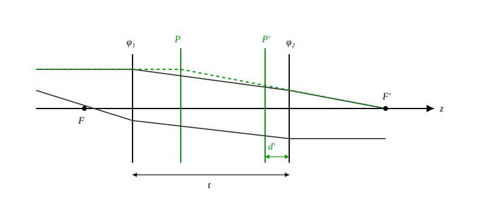

# 高斯约化（Gaussian Reduction）与双光组等效系统

## 1. 公式来源与文献溯源

幻灯片中的高斯约化公式是**近轴几何光学（Gaussian Optics）**与**矩阵光学（Matrix Optics）**中用于求解复合光学系统的经典关系式，主要来源包括：

- **John E. Greivenkamp, *Field Guide to Geometrical Optics* (SPIE Press, 2004)**：在第 12–13 页的方程汇总部分，系统给出了双组分系统组合的光焦度、主平面位移以及等效焦距方程。
- **Max Born & Emil Wolf, *Principles of Optics* (7th ed., Cambridge University Press)**：在 §4.4（Gaussian Optics）与 §4.6（Projective transformation combination）中，基于线性分数变换给出了双系统组合的成像规律与基准点变换。
- **John E. Greivenkamp 亚利桑那大学光学课件（OPTI-502: Gaussian Reduction）**：结合光线追迹（Paraxial Raytrace）推导了系统光焦度与主平面移动量。

---

## 2. 核心公式与符号定义

设两光组之间的光学间隔（约化厚度）为 \(\tau = \frac{t}{n_2}\)，则等效系统的核心方程如下：

### ① 等效系统光焦度 (System Power)
\[
 \phi = \phi_1 + \phi_2 - \phi_1 \phi_2 \tau
\]

- \(\phi_1, \phi_2\)：分别为第一、第二光组的独立光焦度；
- \(n_2\)：两光组中间介质的折射率；
- \(t\)：两光组各自像方主平面 \(P_1'\) 与物方主平面 \(P_2\) 之间的物理距离。

### ② 前主平面位移 (Front Principal Plane Shift)
\[
 \frac{d}{n} = \frac{\phi_2}{\phi} \tau \iff d = \frac{n}{n_2} \frac{\phi_2}{\phi} t
\]

- \(d\)：等效系统的前主平面 \(P\) 相对第一光组物方主平面 \(P_1\) 的位移（位于物空间 \(n\) 中）。

### ③ 后主平面位移 (Rear Principal Plane Shift)
\[
 \frac{d'}{n'} = -\frac{\phi_1}{\phi} \tau \iff d' = -\frac{n'}{n_2} \frac{\phi_1}{\phi} t
\]

- \(d'\)：等效系统的后主平面 \(P'\) 相对第二光组像方主平面 \(P_2'\) 的位移（位于像空间 \(n'\) 中，负号表示偏移方向）。

### ④ 等效后截距与焦距延伸 (Back Focal Distance)
结合像方主平面位置，可直接求得后截距 \(BFD\) 与等效后焦距 \(f_R'\)：
\[
 \text{BFD} = f_R' + d', \quad \text{其中} \quad f_R' = \frac{n'}{\phi}
\]

---

## 3. 物理过程与光线追迹逻辑

1. **光线追迹法（Paraxial Raytrace）**：一束平行于光轴（高度为 \(y_1\)）的入射光依次经过两个透镜折射。
2. **系统主平面定义**：将整个双光组系统的出射光线反向延长，与入射平行光延长线相交于高度同为 \(y_1\) 的平面处，即唯一确定系统的等效像方主平面 \(P'\)。
3. **约化厚度意义**：由于介质折射率的不同，光线的实际传播距离 \(t\) 在相空间中的作用等效于约化距离 \(\tau = t/n_2\)。

---

## 4. 双光组高斯约化光路示意图

> **图示说明**：黑色实线分别代表真实的近轴光线（对应原始双光组系统），绿色虚线代表等效约化后单一等效薄透镜的主平面基准和等效光线传播路径；等效主平面 \(P\) 和 \(P'\) 处满足单位垂轴放大率条件。

---

## 5. 公式推导

本节的推导统一采用**近轴矩阵光学**：先用两个基本矩阵（光组折射、介质传播）把双光组系统写成一个整体的 \(2\times2\) 系统矩阵，再从矩阵的各个矩阵元读出光焦度与主平面位置，从而逐一导出第 2 节的四个公式。各符号沿用第 2 节定义（\(n, n'\) 为物、像空间折射率，\(n_2\) 为中间介质折射率，\(t\) 为两光组主平面间几何距离，\(\tau=t/n_2\)）。

### 5.1 预备：近轴矩阵光学的两个基本矩阵

光线状态用列向量
\[
 \mathbf{x}=\begin{pmatrix} y \\ u \end{pmatrix}, \qquad u=n\tan\theta\approx n\theta
\]
描述，其中 \(y\) 是光线相对光轴的高度，\(u\) 是"约化角度"——几何角 \(\theta\) 与所在介质折射率 \(n\) 的乘积（近轴下 \(\tan\theta\approx\theta\)）。之所以用 \(u\) 而非 \(\theta\)，是因为折射前后 \(u\) 的跃变量恰好只由光焦度决定（见下式），使串联计算保持线性形式。

**(1) 薄光组折射**：光线经过光焦度 \(\phi\) 的薄光组时，高度不变，约化角度减小 \(y\phi\)：
\[
 \begin{pmatrix} y' \\ u' \end{pmatrix}
 =\begin{pmatrix} 1 & 0 \\ -\phi & 1 \end{pmatrix}
 \begin{pmatrix} y \\ u \end{pmatrix},
 \qquad
 \mathbf{R}(\phi)=\begin{pmatrix} 1 & 0 \\ -\phi & 1 \end{pmatrix}.
\]
特例验证：对空气中的单薄透镜（\(\phi=1/f\)），平行光入射（\(u=0\)，高度 \(y\)），出射约化角度 \(u'=-y/f\)，几何角 \(\theta'=u'=-y/f\)——恰好指向位于 \(f\) 处的焦点，与常识一致。

**(2) 介质传播**：在折射率 \(n\)、几何长度 \(t\) 的均匀介质中传播时，约化角度不变、高度增加 \((t/n)u\)：
\[
 \begin{pmatrix} y' \\ u' \end{pmatrix}
 =\begin{pmatrix} 1 & \tau \\ 0 & 1 \end{pmatrix}
 \begin{pmatrix} y \\ u \end{pmatrix},
 \qquad
 \mathbf{T}(\tau)=\begin{pmatrix} 1 & \tau \\ 0 & 1 \end{pmatrix}, \quad \tau=\frac{t}{n}.
\]
验证：几何上 \(y'=y+t\tan\theta=y+t\theta=y+(t/n)u\)，故传播矩阵的空间元必然是约化厚度 \(\tau=t/n\)。

### 5.2 系统矩阵与光焦度 \(\phi\)（公式①）

设光线在物方主平面 \(P_1\) 处进入系统，状态为 \((y_1,\,u_1)\)。依次经第一光组折射、中间介质传播、第二光组折射：
\[
 \mathbf{x}_1^+=\mathbf{R}(\phi_1)\,\mathbf{x}_1,\qquad
 \mathbf{x}_2=\mathbf{T}(\tau)\,\mathbf{x}_1^+,\qquad
 \mathbf{x}_2'=\mathbf{R}(\phi_2)\,\mathbf{x}_2,
\]
故系统矩阵为三个矩阵之积：
\[
 \mathbf{M}=\mathbf{R}(\phi_2)\,\mathbf{T}(\tau)\,\mathbf{R}(\phi_1).
\]
先算中部两个矩阵：
\[
 \mathbf{T}(\tau)\,\mathbf{R}(\phi_1)
 =\begin{pmatrix} 1 & \tau \\ 0 & 1 \end{pmatrix}
  \begin{pmatrix} 1 & 0 \\ -\phi_1 & 1 \end{pmatrix}
 =\begin{pmatrix} 1-\phi_1\tau & \tau \\ -\phi_1 & 1 \end{pmatrix},
\]
再左乘 \(\mathbf{R}(\phi_2)\)：
\[
 \mathbf{M}
 =\begin{pmatrix} 1 & 0 \\ -\phi_2 & 1 \end{pmatrix}
  \begin{pmatrix} 1-\phi_1\tau & \tau \\ -\phi_1 & 1 \end{pmatrix}
 =\begin{pmatrix} 1-\phi_1\tau & \tau \\ -\phi_2(1-\phi_1\tau)-\phi_1 & 1-\phi_2\tau \end{pmatrix}.
\]
左下角矩阵元的负值即为系统光焦度：
\[
 \phi_2(1-\phi_1\tau)+\phi_1=\phi_1+\phi_2-\phi_1\phi_2\tau\equiv\phi.
\]
该量的物理含义由平行光入射读出：取 \(u_1=0\)，出射约化角度
\[
 u_2'=-\big(\phi_1+\phi_2-\phi_1\phi_2\tau\big)\,y_1=-\phi\,y_1,
\]
即整个系统对平行光的偏转行为与一个光焦度 \(\phi\) 的薄光组完全相同，故定义系统光焦度（即公式①）：
\[
 \boxed{\phi=\phi_1+\phi_2-\phi_1\phi_2\tau}\,.
\]
特例检验：当两光组密贴（\(t\to0,\ \tau\to0\)）时 \(\phi\to\phi_1+\phi_2\)，退化为组合光焦度直接相加，符合直觉。

### 5.3 主平面位移 \(d,\,d'\)（公式②③）

把系统矩阵重新分解为"传播—薄光组—传播"的等效三段结构。设等效薄光组（光焦度为 \(\phi\)）的前、后平面分别位于输入面之后约化距离 \(\tau_1\)、输出面之前约化距离 \(\tau_2\) 处，即要求
\[
 \mathbf{M}=\mathbf{T}(\tau_2)\,\mathbf{R}(\phi)\,\mathbf{T}(\tau_1)
 =\begin{pmatrix} 1-\tau_2\phi & \tau_1+\tau_2-\phi\tau_1\tau_2 \\ -\phi & 1-\phi\tau_1 \end{pmatrix}.
\]
与 5.2 的 \(\mathbf{M}=\begin{pmatrix} 1-\phi_1\tau & \tau \\ -\phi & 1-\phi_2\tau \end{pmatrix}\) 逐项比较：

- (2,1) 元：两侧均为 \(-\phi\)，恒等；
- (2,2) 元：\(1-\phi\tau_1=1-\phi_2\tau\)，得
\[
 \tau_1=\frac{\phi_2}{\phi}\,\tau;
\]
- (1,1) 元：\(1-\tau_2\phi=1-\phi_1\tau\)，得
\[
 \tau_2=\frac{\phi_1}{\phi}\,\tau;
\]
- (1,2) 元：代入 \(\tau_1,\tau_2\) 作自洽性检验，
\[
 \tau_1+\tau_2-\phi\tau_1\tau_2
 =\frac{(\phi_1+\phi_2)\tau}{\phi}-\frac{\phi_1\phi_2\tau^2}{\phi}
 =\frac{(\phi_1+\phi_2-\phi_1\phi_2\tau)\,\tau}{\phi}=\tau,
\]
与 \(\mathbf{M}\) 的 (1,2) 元一致。

物理含义：

- **前主平面**：等效薄光组位于输入面（\(P_1\)）之后约化距离 \(\tau_1\) 处。前主平面 \(P\) 相对 \(P_1\) 沿光传播方向移动，其位移 \(d\) 满足 \(d/n=\tau_1\)（物空间折射率为 \(n\)），故（即公式②）
\[
 \frac{d}{n}=\frac{\phi_2}{\phi}\,\tau
 \quad\Longrightarrow\quad
 \boxed{d=\frac{n}{n_2}\frac{\phi_2}{\phi}\,t}\,.
\]
- **后主平面**：等效薄光组的后主平面位于输出面（\(P_2'\)）之前约化距离 \(\tau_2\) 处，即相对 \(P_2'\) 逆光传播方向偏移。后主平面位移 \(d'\) 定义在像空间（折射率 \(n'\)）中，\(d'/n'=-\tau_2\)，负号表示向物方偏移（即公式③）：
\[
 \frac{d'}{n'}=-\frac{\phi_1}{\phi}\,\tau
 \quad\Longrightarrow\quad
 \boxed{d'=-\frac{n'}{n_2}\frac{\phi_1}{\phi}\,t}\,.
\]

特例检验：\(\tau=0\) 时 \(d=d'=0\)，两个主平面回到各自光组的主平面位置，系统退化为单个等效薄光组。

### 5.4 等效焦距与后截距 \(BFD\)（公式④）

**(1) 等效像方焦距**：系统对平行光的总偏转为 \(u_2'=-\phi y_1\)，与单个光焦度 \(\phi\) 的光组完全一致，故等效像方焦距
\[
 f_R'=\frac{n'}{\phi}.
\]

**(2) 后截距**：后截距 \(BFD\) 定义为自输出面（\(P_2'\)）沿像空间到像方焦点的距离。平行光入射时，光线在输出面处的高度（取 \(\mathbf{M}\) 的 (1,1) 元）为
\[
 y_2=(1-\phi_1\tau)\,y_1,
\]
出射约化角度 \(u_2'=-\phi y_1\)。光线继续传播约化距离
\[
 s=\frac{y_2}{-u_2'}=\frac{1-\phi_1\tau}{\phi}
\]
后高度降为 0，即到达像方焦点；折算为物理距离，
\[
 \text{BFD}=n'\,s=\frac{n'(1-\phi_1\tau)}{\phi}.
\]
**(3) 组合关系**：把 5.3 的 \(d'=-n'\phi_1\tau/\phi\) 代入 \(f_R'+d'\)：
\[
 f_R'+d'=\frac{n'}{\phi}-\frac{n'\phi_1\tau}{\phi}
 =\frac{n'(1-\phi_1\tau)}{\phi}
 =\text{BFD},
\]
即得（公式④）
\[
 \boxed{\text{BFD}=f_R'+d'}\,,\qquad f_R'=\frac{n'}{\phi}\,.
\]
物理解释：等效后主平面 \(P'\) 相对输出面逆光方向移动了 \(|d'|\)，而像方焦点相对 \(P'\) 固定在 \(f_R'\) 处；由输出面量起的后截距等于 \(f_R'\) 减去偏移量 \(|d'|\)——当 \(\phi_1>0\)、\(\phi>0\) 时 \(d'<0\)，故 \(BFD<f_R'\)，即"后截距短于等效焦距"，这正是主平面平移在焦点读数上的体现。

### 5.5 为什么必须使用约化厚度

推导中所有空间变量都以约化形式出现（\(\tau=t/n_2\)、\(d/n\)、\(d'/n'\)），这不是记法偏好，而是自洽性的要求：折射矩阵 \(\mathbf{R}(\phi)\) 之所以取简单形式 \(\begin{pmatrix}1 & 0\\ -\phi & 1\end{pmatrix}\)，前提是把状态分量选定为约化角度 \(u=n\theta\)；与之配套，传播矩阵 \(\mathbf{T}(\tau)\) 中的空间元必然是对应于 \(u\) 的约化长度 \(\tau=t/n\)（见 5.1 的传播验证式 \(y'=y+(t/n)u\)）。几何长度 \(t\) 无法直接参与矩阵串联，只有约化为 \(\tau\) 后才能把不同折射率的介质统一到同一线性框架。最后把约化量乘回介质折射率（\(d=n\,\tau_1\)、\(d'=n'\,\tau_2\)），即恢复为 ②③ 中带 \(n/n_2\)、\(n'/n_2\) 系数的物理位移。

---

## 6. 参考文献

1. Greivenkamp, J. E. *Field Guide to Geometrical Optics* (Vol. 1). SPIE Press, 2004: 12-13.
2. Born, M., & Wolf, E. *Principles of Optics: Electromagnetic Theory of Propagation, Interference and Diffraction of Light* (7th ed.). Cambridge University Press, 1999: §4.4, §4.6.
3. Greivenkamp, J. E. *Gaussian Reduction*. OPTI-502 Optical Design and Instrumentation I, College of Optical Sciences, University of Arizona.
