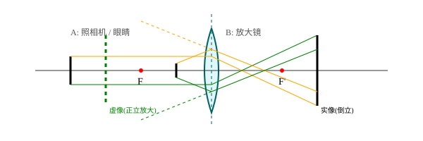
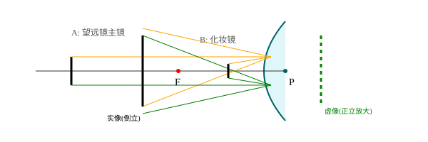
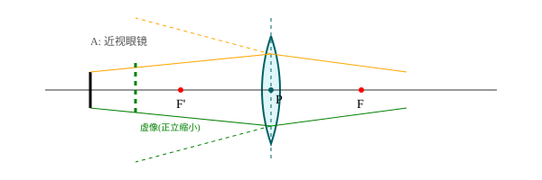
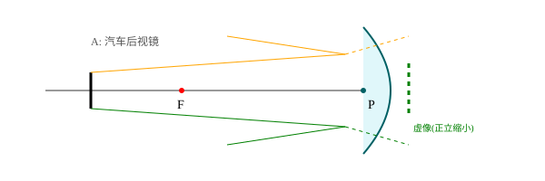

# Object-Image Zones: Imaging Regions for Four Basic Optical Elements

This figure is the classic **object-image zones** diagram from geometrical optics. It divides an optical system (lens or mirror) into different zones and indicates the nature of the image (real/virtual, magnified/reduced, erect/inverted) formed when the object lies in each zone.

Meaning of the key symbols in the figure:
*   **\(P, P'\)**: object-side and image-side principal planes (for a thin lens or mirror these coincide at the center).
*   **\(F, F'\)**: object-side and image-side focal points.
*   **White zones**: represent **real** images.
*   **Green zones**: represent **virtual** images.
*   **\(m\)**: transverse magnification. \(m>0\) erect, \(m<0\) inverted; \(|m|>1\) magnified, \(|m|<1\) reduced.
*   **\(\phi\)**: optical power. \(\phi>0\) is a positive (converging) system, \(\phi<0\) a negative (diverging) system.
*   **\(n'\)**: image-space refractive index. \(n'>0\) denotes a refracting (transmitting) system, \(n'<0\) a reflecting system.

These four cases correspond to the four most common basic optical elements in everyday life. Below is a detailed explanation of each scenario and its real-life applications, accompanied by SVG ray diagrams to aid understanding.

---

### 1. Positive-Power System - Refracting (\( \phi>0; n'>0 \))
**Element: convex lens (converging lens)**
**Real-world applications: camera, human eye, magnifying glass**

*   **Zone A (object distance \(> F\))**：the object lies beyond the focus. Forms a **real image (white)**, **inverted (\(m<0\))**. If the object is beyond \(2F\), a reduced inverted real image forms (camera principle); between \(F\) and \(2F\), a magnified inverted real image forms (projector principle).
*   **Zone B (object distance \(< F\))**：the object lies between the focus and the lens. Forms a **virtual image (green)**, **erect (\(m>1\) magnified)**. This is the **magnifying glass** principle.
*   **Zone C (virtual object zone)**：the object lies behind the lens (a virtual object formed by unconverged rays from a previous optical system). Forms a **real image (white)**, **erect (\(0<m<1\) reduced)**.

---

### 2. Positive-Power System - Reflecting (\( \phi>0; n'<0 \))
**Element: concave mirror**
**Real-world applications: makeup/shaving mirror, astronomical telescope primary mirror, flashlight reflector**

Because it is a reflecting system, the direction of image space (\(z'\)) is opposite to that of object space (\(z\)).
*   **Zone A (object distance \(> F\))**：the object lies outside the focus. Forms a **real image (white)**, **inverted (\(m<0\))**. For example, in an astronomical telescope, distant starlight converges near the focus into an inverted real image.
*   **Zone B (object distance \(< F\))**：the object lies inside the focus. Forms a **virtual image (green)**, **erect and magnified (\(m>1\))**. This is the **makeup mirror** principle: with the face close to the mirror (inside the focus), a magnified erect virtual image forms, making details easy to inspect.
*   **Zone C (virtual object zone)**：forms a **real image (white)**, **erect and reduced (\(0<m<1\))**.

---

### 3. Negative-Power System - Refracting (\( \phi<0; n'>0 \))
**Element: concave lens (diverging lens)**
**Real-world applications: nearsighted (myopia) glasses, Galilean telescope eyepiece, door viewer (peephole)**

Note the markers in the figure: for a negative-power system the relative positions of the focus \(F\) and the principal planes \(P\) are reversed compared with a positive system.
*   **Zone A (object distance \(< P\))**：real object. After the rays are diverged, a **virtual image (green)** forms, **erect and reduced**. This is how **nearsighted glasses** work: they create a reduced erect virtual image in front of the retina, allowing eyes that see distant objects as blurry to see clearly.
*   **Zone B (object distance between \(P\) and \(F\), virtual object)**：forms a **real image (white)**, **erect and reduced (\(0<m<1\))**. This usually occurs in multi-lens combination systems (such as camera lens assemblies), where the image formed by one lens serves as the virtual object for the next.
*   **Zone C (object distance \(> F\), virtual object)**：forms a **real image (white)**, **erect and magnified (\(m>1\))**.

---

### 4. Negative-Power System - Reflecting (\( \phi<0; n'<0 \))
**Element: convex mirror**
**Real-world applications: car rearview mirrors, supermarket anti-theft wide-angle mirrors, intersection safety mirrors**

A convex mirror offers an extremely wide field of view (although the image is reduced).
*   **Zone A (real object zone, object in front of \(P\))**：the object is in front of the mirror. Forms a **virtual image (green)**, **erect and reduced (\(0<m<1\))**. This is the **car rearview mirror** principle: the wide view behind is compressed into a small erect virtual image, letting the driver see more, while distances appear pushed further away (because of the reduction).
*   **Zone B (virtual object zone, between \(P\) and \(F\))**：forms a **real image (white)**, **erect and magnified (\(m>1\))**. This case is relatively rare in everyday life, usually occurring in secondary imaging inside instruments.
*   **Zone C (virtual object zone, beyond \(F\))**：forms a **virtual image (green)**, **inverted (\(m<0\))**.

---

### Summary
This figure is a foundational concept in optical design (e.g., in software such as Zemax). When analyzing a complex optical system, rays may pass through lenses and reflect off mirrors countless times, and an object may be a real object or become a virtual object because of convergence from the preceding optical path. **Understanding these four zones (A, B, C) together with their corresponding image-side mappings (A', B', C') lets you quickly hand-calculate, even without a computer, the imaging state at each surface of an optical system (real or virtual, magnified or reduced).**