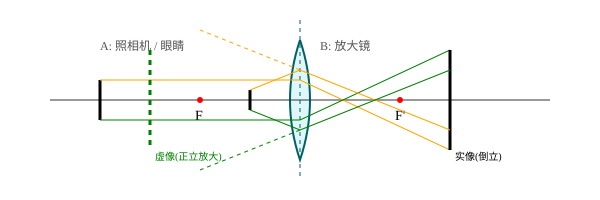
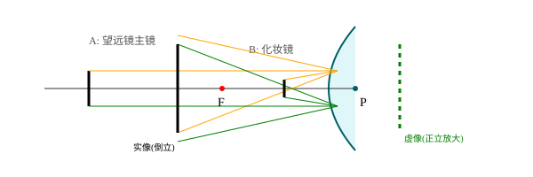
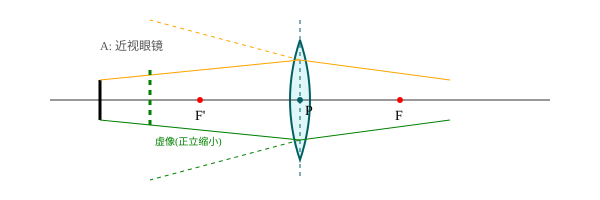
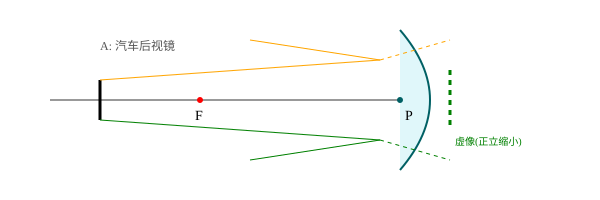

# 物像区域：四种基础光学元件的成像分区

这份图片展示的是几何光学中经典的**物像区域（Object-Image Zones）**分布图。它将光学系统（透镜或反射镜）分为不同的区域，并标明了物体在不同区域时，所成像的性质（实像/虚像、放大/缩小、正立/倒立）。

图中几个关键符号的含义：
*   **\(P, P'\)**：物方主平面和像方主平面（通常薄透镜/面镜重合于中心）。
*   **\(F, F'\)**：物方焦点和像方焦点。
*   **白色区域**：代表**实像（Real）**。
*   **绿色区域**：代表**虚像（Virtual）**。
*   **\(m\)**：横向放大率。\(m>0\) 正立，\(m<0\) 倒立；\(|m|>1\) 放大，\(|m|<1\) 缩小。
*   **\(\phi\)**：光焦度。\(\phi>0\) 为正（会聚）系统，\(\phi<0\) 为负（发散）系统。
*   **\(n'\)**：像方折射率。\(n'>0\) 代表折射系统（透射），\(n'<0\) 代表反射系统（反射）。

这四种情况分别对应了我们生活中最常见的四种基础光学元件。下面为你详细解释这四种场景及其对应的真实生活应用，并配有辅助理解的SVG光路图。

---

### 1. 正光焦度系统 - 折射 (\( \phi>0; n'>0 \))
**对应元件：凸透镜（会聚透镜）**
**真实场景：照相机、人眼、放大镜**

*   **区域 A (物距 \(> F\))**：物体在焦点之外。成**实像（白色）**，**倒立（\(m<0\)）**。如果物体在 \(2F\) 之外，成缩小倒立实像（照相机原理）；在 \(F\) 到 \(2F\) 之间，成放大倒立实像（投影仪原理）。
*   **区域 B (物距 \(< F\))**：物体在焦点和透镜之间。成**虚像（绿色）**，**正立（\(m>1\)放大）**。这就是**放大镜**的原理。
*   **区域 C (虚物区)**：物体位于透镜后方（通常是前一个光学系统产生的未汇聚光线形成的虚物）。成**实像（白色）**，**正立（\(0<m<1\)缩小）**。

---

### 2. 正光焦度系统 - 反射式 (\( \phi>0; n'<0 \))
**对应元件：凹面镜**
**真实场景：化妆镜/剃须镜、天文望远镜主镜、手电筒反光碗**

因为是反射系统，像空间（\(z'\)）的方向与物空间（\(z\)）相反。
*   **区域 A (物距 \(> F\))**：物体在焦点外。成**实像（白色）**，**倒立（\(m<0\)）**。例如天文望远镜，远处星光在焦点附近汇聚成倒立实像。
*   **区域 B (物距 \(< F\))**：物体在焦点内。成**虚像（绿色）**，**正立放大（\(m>1\)）**。这就是**化妆镜**的原理，脸贴在镜子前（焦点内）能成放大的正立虚像，方便看清细节。
*   **区域 C (虚物区)**：成**实像（白色）**，**正立缩小（\(0<m<1\)）**。

---

### 3. 负光焦度系统 - 折射 (\( \phi<0; n'>0 \))
**对应元件：凹透镜（发散透镜）**
**真实场景：近视眼镜、伽利略望远镜目镜、门镜（猫眼）**

注意图中的标记，对于负光焦度系统，焦点 \(F\) 和主平面 \(P\) 的相对位置与正系统相反。
*   **区域 A (物距 \(< P\))**：实物。光线经过发散，成**虚像（绿色）**，**正立缩小**。这就是**近视眼镜**的作用，将眼前的物体在视网膜前产生一个缩小的正立虚像，让原本看远处模糊的眼睛能看清。
*   **区域 B (物距在 \(P\) 与 \(F\) 之间，虚物)**：成**实像（白色）**，**正立缩小（\(0<m<1\)）**。通常出现在多透镜组合系统（如相机镜头组）中，前一透镜产生的像作为后一透镜的虚物。
*   **区域 C (物距 \(> F\)，虚物)**：成**实像（白色）**，**正立放大（\(m>1\)）**。

---

### 4. 负光焦度系统 - 反射式 (\( \phi<0; n'<0 \))
**对应元件：凸面镜**
**真实场景：汽车后视镜、超市防盗广角镜、路口反光镜**

凸面镜具有极大的视野（虽然图像会被缩小）。
*   **区域 A (实物区，物在 \(P\) 之前)**：物体在镜前。成**虚像（绿色）**，**正立缩小（\(0<m<1\)）**。这就是**汽车后视镜**的原理，将后方的广阔视野压缩成一个小的正立虚像，让驾驶员看得更宽，但距离感会被拉远（因为缩小了）。
*   **区域 B (虚物区，在 \(P\) 和 \(F\) 之间)**：成**实像（白色）**，**正立放大（\(m>1\)）**。这种情况在实际生活中较少见，通常发生在仪器内部的二次成像。
*   **区域 C (虚物区，在 \(F\) 之后)**：成**虚像（绿色）**，**倒立（\(m<0\)）**。

---

### 总结
这张图其实是光学设计（如Zemax等软件）中的基础概念。在分析复杂的光学系统时，光线可能无数次穿过透镜、被镜子反射，物体可能处于"实物"状态，也可能因为前一段光路的汇聚而变成"虚物"。**了解这四大区块（A、B、C）以及像方的对应映射（A'、B'、C'），就能在没有计算机的时代，快速手算出光学系统中各个面的成像状态（是实是虚，放大还是缩小）。**